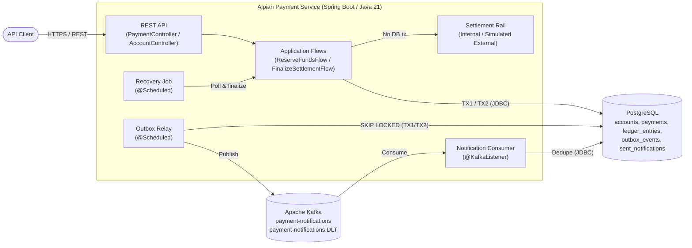

# Architecture

## 1. Purpose & Scope

This project is a **Proof of Concept (PoC)** payment service built with Spring Boot, PostgreSQL, and Apache Kafka to demonstrate transactional integrity, idempotent API design, and resilient event delivery. It handles internal account-to-account transfers and simulated external IBAN settlements, emitting payment lifecycle notifications via Kafka. It is **not production-grade**: authentication, real banking rail integrations (SEPA/SWIFT/cards), FX conversion, fraud/AML checks, and multi-node infrastructure deployment are intentionally omitted (see [Design, Assumptions & Philosophy](design-assumptions-philosophy.md) and [ADR-0005](adr/0005-out-of-scope-features.md)).

---

## 2. Architecture at a Glance

The service runs as a single deployable Spring Boot unit with logically separated modules (`Payment Service` core and colocated `Notification` consumer) backed by PostgreSQL and Kafka:



---

## 3. Source Code Organization

The codebase follows a **light hexagonal architecture** (`ADR-0006`) organized under `ch.alpian.payment`:

```text
src/main/java/ch/alpian/payment/
├── api/                        # Inbound REST controllers, request/response mappers, RFC 9457 error handler
├── application/
│   ├── events/                 # Integration event types & payloads (PaymentEvents, PaymentPayload)
│   ├── flows/                  # Transaction-boundary orchestrators (CreatePaymentFlow, ReserveFundsFlow, FinalizeSettlementFlow, ...)
│   ├── support/                # Request hashing & transient DB deadlock/lock-timeout retry (TransactionRetry)
│   └── tasks/                  # Single-purpose, non-transactional building blocks composed by flows
├── domain/                     # Pure domain model (Payment, Account, Money, Receiver), ports, and domain exceptions
├── infrastructure/
│   ├── messaging/              # Kafka topology/error-handler config (KafkaConfig) & OutboxRelay
│   ├── persistence/            # Spring Data JDBC / JdbcClient adapters & OutboxStore
│   ├── rail/                   # InternalTransferRail & SimulatedExternalRail
│   └── recovery/               # RecoveryJob for stale RESERVED payments
└── notification/               # Colocated Kafka consumer (NotificationConsumer) & dedupe store (SentNotificationStore)
```

Architectural boundaries are enforced at build time by ArchUnit (`ArchitectureTest`):
- `domain` has zero dependencies on Spring Web/Context/Kafka or outer application layers.
- `api` and `application` cannot depend directly on `infrastructure`; they communicate through `domain` ports.
- Only **flows** (not `tasks`) may declare `@Transactional` boundaries.

---

## 4. Data & Consistency

### Where State Lives

PostgreSQL is the single source of truth across seven tables:
- **`accounts`**: Customer and `CLEARING` accounts (`balance`, `available_balance`, currency). CHF clearing accounts are sharded across 8 rows (`V5__clearing_account_shards.sql`) to reduce lock contention.
- **`payments`**: Payment lifecycle state (`RESERVED`, `COMPLETED`, `FAILED`, `REJECTED`), `idempotency_key` + `request_hash` unique constraint, and `settlement_attempts`.
- **`ledger_entries`**: Immutable double-entry debit/credit records written atomically when a payment reaches `COMPLETED`.
- **`outbox_events`**: Pending and published domain events (`published_at`, `claimed_at`, `publish_attempts`, `dead_lettered_at`).
- **`sent_notifications`**: Consumer-side deduplication log keyed by `event_id`.
- **`rail_sim_transfers`**: Simulated external rail state for idempotent `settle` / `getStatus` calls.
- **`shedlock`**: Lock table schema for scheduled job coordination.

More in detail in [Database](docs/database.md) section.

### Avoiding the Dual-Write Problem

To prevent the **dual-write problem** (where a database commit succeeds but a direct Kafka publish fails, or vice versa), the service uses the **Transactional Outbox** pattern (`ADR-0003`):

1. **Atomic DB write:** Within the same PostgreSQL transaction (`ReserveFundsFlow` or `FinalizeSettlementFlow`), `WriteOutboxTask` inserts an `EventEnvelope` row into `outbox_events` alongside the `payments`, `accounts`, and `ledger_entries` changes. Either both commit or neither does.
2. **Asynchronous relay:** `OutboxRelay` runs on a schedule (`500 ms`), claims unpublished rows in a short transaction using `FOR UPDATE SKIP LOCKED`, sends them to Kafka outside any DB transaction, and marks `published_at` in a second short transaction.
3. **At-least-once + idempotent consumer:** If the relay crashes between Kafka ack and marking `published_at`, the row is reclaimed after `claim-ttl-ms` (`30 s`) and re-sent. `NotificationConsumer` handles redeliveries idempotently by inserting `event_id` into `sent_notifications` with `ON CONFLICT (event_id) DO NOTHING` (`ADR-0017`).
