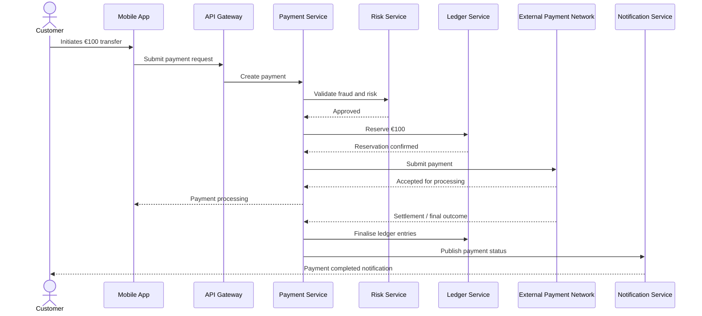

# Design, Assumptions & Philosophy

## Initial Design and Evolution

The goal of this project is to design and build a resilient, production-minded payment service.

In a typical banking architecture, creating a payment involves several collaborating services:

Looking at that flow, the Payment Service sits at the center of two kinds of communication:
- **Inbound requests** from upstream callers (e.g., an API gateway or mobile backend).
- **Outbound interactions** with downstream systems—most notably external payment networks (rails) and notification delivery.

For a focused, one-week build, spinning up separate dummy microservices for every box in that diagram would add operational overhead without adding much value to the core problem. Instead, the project is structured as a **single deployable unit** with internal module boundaries (`ADR-0019`):
- **Notifications** live in the same application as a colocated Kafka consumer module.
- **External settlement** is abstracted behind a `SettlementRail` port (`ADR-0014`), with `InternalTransferRail` for internal account-to-account transfers and `SimulatedExternalRail` for external IBAN transfers.

### Phased Delivery

Real-world payment networks typically process settlement asynchronously, accepting a payment instruction before delivering its final outcome. Rather than introducing the full asynchronous lifecycle upfront, settlement is implemented incrementally to keep the initial scope manageable.
- **Phase 1 (~~`v1.0.0`~~ `v1.0.1`, current):** External settlement is modeled behind the `SettlementRail` port and attempted **synchronously inside the HTTP request** (`ADR-0015`). If the rail returns `SETTLED` or `REJECTED`, the payment is finalized immediately (`201 Created`). If the rail times out or returns `UNKNOWN`, the service holds the funds in `RESERVED`, returns `202 Accepted` with a `Location` header, and lets `RecoveryJob` poll `getStatus` and finalize the payment in the background (`ADR-0021`).
- **Phase 1.5 (`v1.1.0`, proposed in [ADR-0020](adr/0020-async-external-rail-callback-endpoint.md)):** Introduce an asynchronous **callback endpoint** (`POST /internal/settlements/{paymentId}/result`) so an external rail can accept a submission and deliver the final outcome after a delay. Because every state transition uses a guarded `UPDATE ... WHERE status = :from` (`ADR-0013`), duplicate or out-of-order callbacks are naturally idempotent. There is a rough implementation of this approach in [the branch APS-028](https://github.com/Luisa13/Alpian-Payment-Service/pull/29)
---

## Engineering Focus

The primary focus of this assignment is **high availability, transactional integrity, and error handling**:

- **Horizontal scalability:** Application instances are stateless and can scale horizontally behind a load balancer, with no dependency on local in-memory state for correctness.
- **Resilient event delivery:** Payment state transitions and outbox event records are persisted atomically in PostgreSQL (`ADR-0003`). This decouples payment processing from Kafka availability, allowing events to accumulate in the outbox during broker outages and be published once service is restored. Backlog monitoring is exposed through `outbox.backlog.events`.
- **Reliable messaging:** Kafka is configured for fault tolerance with 6 partitions and a replication factor of 3 by default. Producers use `acks=all` and idempotence, while consumers apply exponential-backoff retries and route exhausted retries to a Dead-Letter Topic (`payment-notifications.DLT`).
- **Transaction boundaries optimized for concurrency:** External rail calls and Kafka publishing are kept outside database transactions to minimize lock contention. Payment processing follows a reserve–execute–finalize flow across two short transactions, with transient deadlocks and lock timeouts handled through jittered retries (`TransactionRetry`).
---

## Assumptions & Scope

This project lives and has been developed within certain boundaries. Generally, those boundaries are defined by assumptions, but stating this in this way would be an oversimplification. The scope where this project lives is defined by assumptions, later decisions and trade-offs.
The assumptions are something I take as true about the world prior to either the general design or the specific design of a process. Decisions (and later decisions) comes from picking one among different options.
This is described between this section and [ADRs](docs/adr).

- **Secret rotation is out of scope**; GCP Secret Manager is the recommended solution.
- **Gateway handles security**. I'm assuming an API gateway in front of the service authenticates callers, checks that they own the sender account, and applies TLS and rate limits.
- **Callers want an answer right away**. A client expects to learn the result in the same request, or get a 202 and check back later.
- **No real payment network**. Transfers between two of our accounts move money inside our own database. Payments to an external IBAN are settled by a simulated rail and an internal CLEARING account, not by SEPA, SWIFT or a card network.
- **One currency per payment**. The sender, the receiver and the request all use the same currency.
- **Simple balance rule**. A payment is accepted if the sender has enough available funds. Accounts can never go below zero, so there is no overdraft.
- **Payments are final**. Once a payment reaches a final state, it never changes (ADR-0005).
- **Notifying the sender means publishing an event**. I publish a Kafka event and record it in sent_notifications. No email or SMS provider is involved.
- **Advanced outbox delivery guarantees**: Cross-replica event ordering and CDC-based outbox delivery are outside the scope of this implementation.
- **Additional platform and payment capabilities**: Asynchronous external rail callbacks and webhooks (ADR-0020), multi-currency settlement and FX, API authentication and rate limiting, and archival of historical payments and outbox_events data are not covered.

---

### Key Design Decisions & Trade-offs
- **Single PostgreSQL database with sharded clearing rows:** PostgreSQL is the single source of truth without cross-node DB sharding, allowing a single transaction to atomically lock accounts and post double-entry ledger records. To prevent single-row lock contention during concurrent external settlements, CHF `CLEARING` accounts are sharded across 8 rows (`V5__clearing_account_shards.sql`).
- **Pessimistic locking for moderate account contention:** Sender accounts use row-level locking (`SELECT ... FOR UPDATE`, `ADR-0011`), which is simple and safe for typical customer accounts. A high-throughput "hot" account (such as a major merchant receiving thousands of payments per second) would require an asynchronous/batching ledger pattern instead.

## Improvements for Production ready:
- Security: Left out on purpose for this project, but authorization and authentication are an non-negotiable for a bank. Same goes for secret management.
- Rate Limiting : As is mentioned before, I'm assuming an external gateway handles security and enforces per-client rate limits at the edge, rejecting excess requests so the API never receives more traffic than it can handle.
- Settlement asynchronously via callbacks/webhooks: This is proposed in [ADR-0020](docs/adr/0020-async-external-rail-callback-endpoint.md) in an attempt to close the gap of a more realistic representation. It was intended in the Phase 1.5
- Monitoring and Observability: Didn't have time to build a dashboard for this version in the end