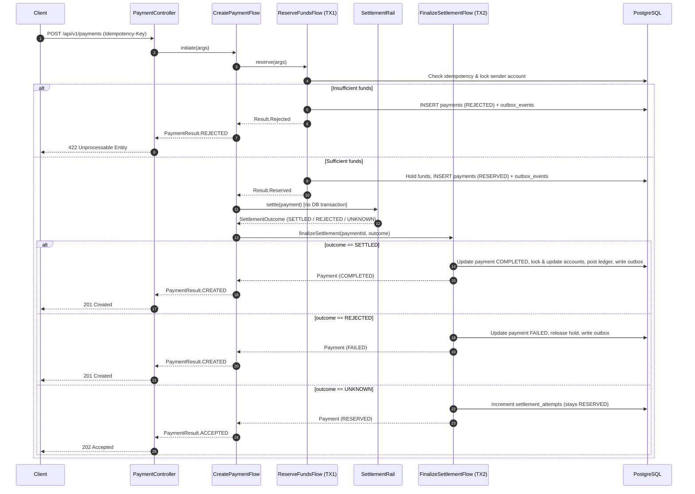
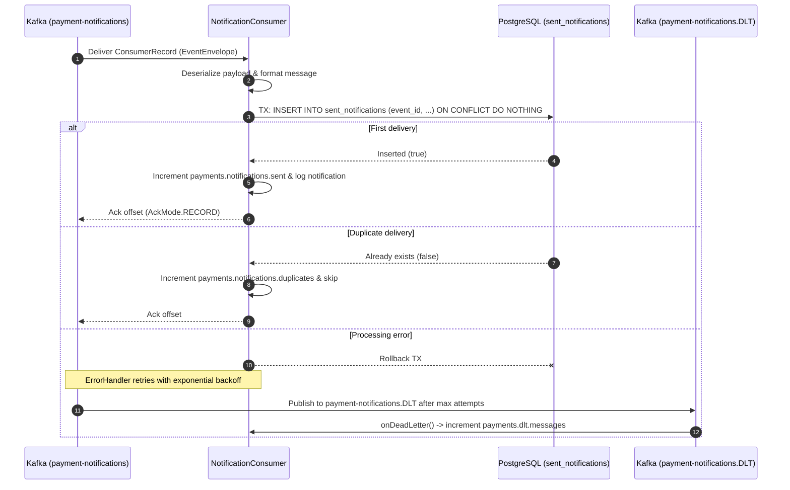

# Flows

This document describes the core application and messaging flows in the Payment Service.

---

## 1. Create Payment Flow

`CreatePaymentFlow` orchestrates payment intake and synchronous settlement inside a single HTTP request (`POST /api/v1/payments`) while keeping database transactions short and never holding a DB lock across a rail call:



---

## 2. Outbox Relay Flow

`OutboxRelay` implements the **claim-then-send** transactional outbox pattern on a fixed schedule (`app.outbox.relay-interval-ms`):

```mermaid
sequenceDiagram
    autonumber
    participant SCHED as OutboxRelay (@Scheduled)
    participant DB as PostgreSQL (outbox_events)
    participant K as Kafka (payment-notifications)

    SCHED->>DB: TX1: SELECT ... WHERE published_at IS NULL AND (claimed_at IS NULL OR expired) FOR UPDATE SKIP LOCKED
    SCHED->>DB: TX1: UPDATE outbox_events SET claimed_at = now()
    DB-->>SCHED: Claimed batch (up to 100 rows)

    loop For each row in batch
        SCHED->>K: Send ProducerRecord (key=aggregate_id, headers=eventId,eventType)
        alt Broker acks within ack-timeout-ms
            K-->>SCHED: Ack
            SCHED->>DB: TX2: UPDATE outbox_events SET published_at = now()
        else Send fails or times out
            K-->>SCHED: Error / Timeout
            SCHED->>DB: TX2: UPDATE publish_attempts + 1, last_error, claimed_at = NULL
            Note over SCHED: Abort batch; retry on next cycle
        end
    end
```

---

## 3. Notification Flow

`NotificationConsumer` consumes payment lifecycle events from Kafka and sends idempotent notifications to payment senders:


